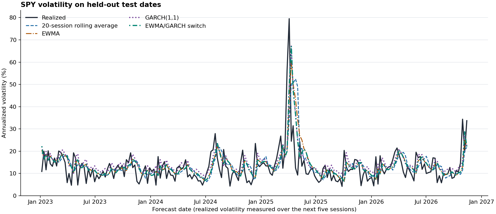

# SPY volatility forecasting

Compare a 20-session rolling baseline, EWMA, zero-mean Gaussian GARCH(1,1), and a model that switches between EWMA and GARCH on the same weekly SPY forecast dates.

```powershell
python -m pip install -r requirements.txt
python baseline.py spy.csv --validation-start 2020-01-01 --test-start 2023-01-01
python plot_forecasts.py forecasts.csv
python test_breakdown.py forecasts.csv
python dashboard.py
```

The CSV must contain one row per trading session with columns `Date` (YYYY-MM-DD) and `Adj Close`. Supply at least 252 daily returns before validation and enough data after the test cutoff to observe completed five-session outcomes. Use a continuous history of SPY adjusted closes and omit weekends and market holidays. The command dates are examples. Choose dates that fit your dataset.

The first split date starts validation. Earlier returns provide the initial history. The second starts the held-out test. Each forecast uses information through the last trading close of its week. The target is the sum of the next five squared daily log returns. Validation targets ending on or after the test cutoff are excluded from calibration and scoring.

EWMA selects a decay from 0.90, 0.94, 0.97, and 0.99 by validation QLIKE, then freezes it for the test. The rolling window is fixed at 20. GARCH refits on expanding history at each forecast date and sums its five daily variance forecasts. Test forecasts can use earlier test returns as those returns become available. A variance floor keeps QLIKE defined for flat price histories.

The switch uses annualized volatility from the 20 daily returns available through the forecast close. It selects GARCH above a fixed threshold and EWMA at or below it. It also uses EWMA when a selected GARCH fit fails. The threshold is chosen by minimum QLIKE on common validation dates from the 25th, 40th, 50th, 60th, and 75th percentiles of the validation signal. It is frozen before testing. The realized-volatility groups below are used only to report performance.

`forecasts.csv` includes the forecast date, target end date, realized variance, and each model's prediction in decimal-return variance units. A blank GARCH forecast marks a fit failure. `metrics.csv` reports forecast coverage and scores each model on the same intersection of available dates within each split. Lower QLIKE and annualized volatility MAE are better. Validation scores include the dates used to select EWMA decay. Use the test scores for the held-out comparison.

## Held-out SPY results

The run used 2,486 daily adjusted closes from January 3, 2017 through November 20, 2026. Validation began in 2020 and selected an EWMA decay of 0.90 and a switch threshold of 18.0816% annualized. The switch selected EWMA on 181 test dates and GARCH on 21. All four models produced forecasts on all 202 test dates, from January 6, 2023 through November 13, 2026. The last realized target ended on November 20, 2026. [SPY input](spy.csv) · [Yahoo Finance data mirror](https://github.com/manisahni/marketdata/blob/main/daily_adjclose.csv)

| Model | Test QLIKE | Annualized volatility MAE |
| --- | ---: | ---: |
| GARCH(1,1) | **−6.9018** | 4.80 pp |
| EWMA/GARCH switch | −6.8579 | **4.67 pp** |
| EWMA (decay 0.90) | −6.8518 | 4.72 pp |
| 20-session rolling average | −6.8033 | 4.89 pp |

GARCH had the lowest test QLIKE, beating the switch by 0.0439. The switch improved on EWMA by 0.0061 QLIKE and had the lowest annualized volatility MAE. [Full metrics](metrics.csv) · [Weekly forecasts](forecasts.csv)



The chart places each realized five-session outcome at its forecast date. It converts realized and forecast variance to annualized volatility using the same 252-session convention as the MAE calculation.

### Test QLIKE by forecast year

| Forecast year | Weeks | Rolling average | EWMA | GARCH(1,1) | Switch |
| --- | ---: | ---: | ---: | ---: | ---: |
| 2023 | 52 | −7.0125 | **−7.0247** | −6.9997 | −7.0203 |
| 2024 | 52 | −6.9529 | −7.0154 | **−7.0719** | −7.0166 |
| 2025 | 52 | −6.5370 | −6.5964 | **−6.6905** | −6.6264 |
| 2026 through November 13 | 46 | −6.6988 | −6.7600 | **−6.8375** | −6.7565 |

EWMA led in 2023. GARCH led in 2024, 2025, and the available 2026 test weeks. Bold marks the lowest QLIKE in each row.

### Test QLIKE in calm and volatile weeks

The median realized five-session variance across test weeks corresponds to **11.8514% annualized volatility**. Calm weeks were at or below the median, and volatile weeks were above it. These labels use realized outcomes to describe forecast performance after the fact.

| Regime | Weeks | Rolling average | EWMA | GARCH(1,1) | Switch |
| --- | ---: | ---: | ---: | ---: | ---: |
| Calm | 101 | −7.6053 | −7.6233 | −7.5526 | **−7.6286** |
| Volatile | 101 | −6.0014 | −6.0803 | **−6.2510** | −6.0872 |

The switch edged out EWMA in calm weeks. GARCH beat the switch by 0.1638 QLIKE in volatile weeks. Each row scores the models on identical forecast dates. [Breakdown CSV](test_breakdown.csv)

## Dashboard

Run `python dashboard.py` to open the local desktop dashboard. Use the year filter and series toggles to explore the forecasts. The **Test scores** tab shows the overall ranking, yearly and realized-regime results, the frozen switch threshold, and how often each model was selected. The dashboard reads the saved CSVs and needs Python with Tkinter.

The **Switch choices** tab shows a timeline and a scrollable list of all test forecast dates, including the trailing volatility, model selected, and resulting volatility forecast.
